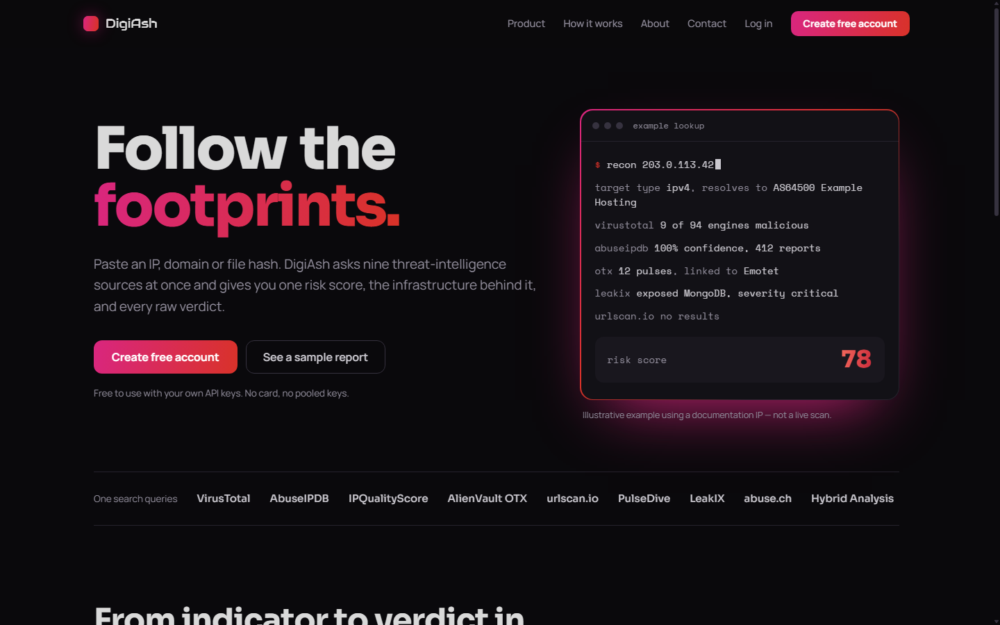
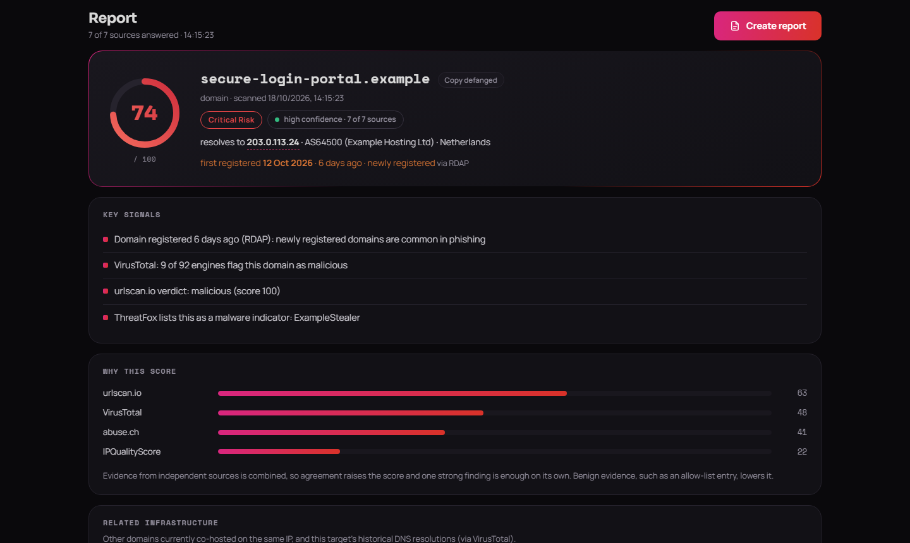
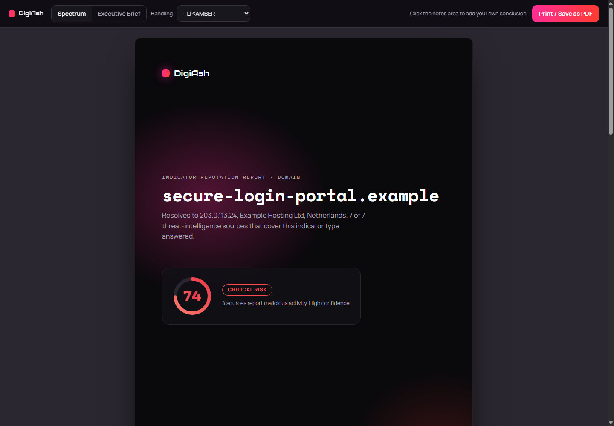
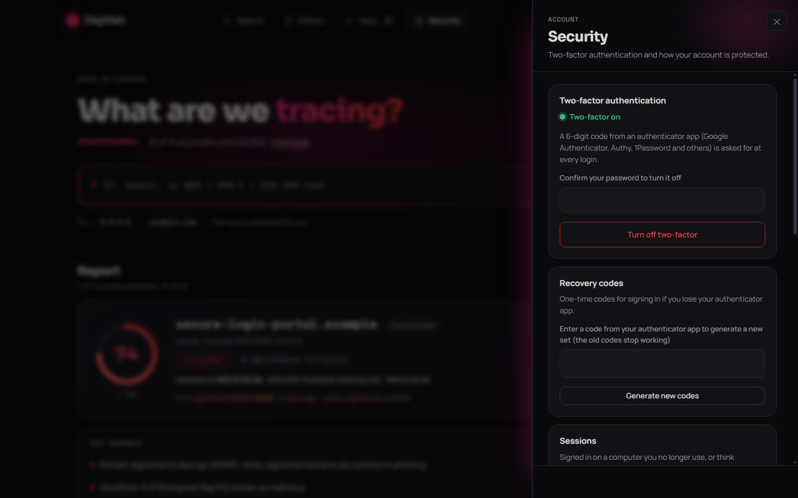
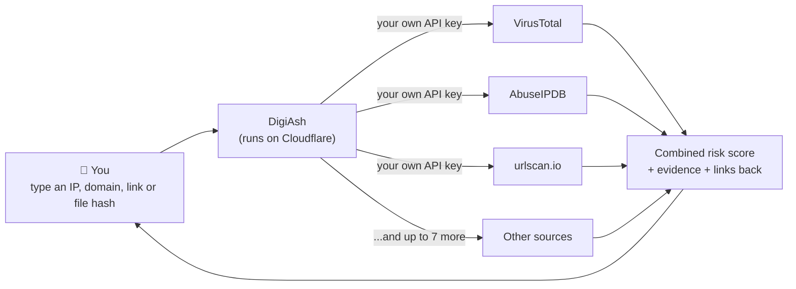
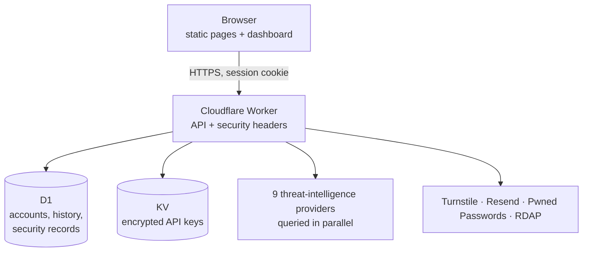

# DigiAsh

**One search across nine threat-intelligence sources.** Paste an IP address, a website domain, a full link or a file's fingerprint, and DigiAsh asks nine security services at once whether they've seen it doing anything harmful. It then combines their answers into a single risk score, with the evidence behind it.

🌐 **Live at [digiash.com](https://digiash.com)** · Free to use with your own API keys · ▶️ **[Try the demo, no account needed](https://digiash.com/sample)**

---

## Contents

- [The problem it solves](#the-problem-it-solves)
- [What it looks like](#what-it-looks-like)
- [How it works](#how-it-works)
- [Key terms, explained](#key-terms-explained)
- [How the risk score works](#how-the-risk-score-works)
- [Security, explained simply](#security-explained-simply)
- [Privacy](#privacy)
- [What this project covers](#what-this-project-covers)
- [For developers](#for-developers)
- [About](#about)

---

## The problem it solves

Imagine you receive an email with a link to `secure-login-portal.example`, and you want to know whether it's safe. Security professionals answer that question by checking the address against several specialist services: one collects reports from antivirus engines, another tracks malware, another scans websites, another records which addresses attack other computers.

Each of those services has its own website and account. Checking one suspicious address can mean opening ten browser tabs, copying the address into each, and piecing the answers together by hand. When you do that many times a day, or need the evidence for a written report, it adds up.

**DigiAsh does the nine checks at once and puts the answers side by side.**

## What it looks like

*The screenshots below use made-up demonstration data: `.example` domains and IP addresses reserved for documentation, which can never belong to a real organisation. You can explore the same demo yourself at [digiash.com/sample](https://digiash.com/sample).*

**A search result.** The score from 0 to 100, how confident DigiAsh is in it, the most important findings, and which services contributed most:

**A printable report.** One click turns a result into a report you can save as a PDF and attach to an investigation:

**Account security settings.** Two-factor authentication, signing out other devices, downloading your data and deleting your account:

## How it works

1. **You sign up once** and connect the services you want to use, by pasting in an *API key* for each one (see the terms below). DigiAsh stores these keys encrypted.
2. **You search.** DigiAsh sends your query to every connected service at the same time, rather than one after another, so a search takes seconds.
3. **DigiAsh combines the answers** into one score and highlights the findings that matter, with a link back to each service so the evidence can be checked and cited.

This model is called **"bring your own key"**: each user connects their own free accounts with the security services, so DigiAsh never shares one account's limits or data between users.

## Key terms, explained

| Term | What it means |
|---|---|
| **IP address** | The numeric address of a computer on the internet, such as `203.0.113.24`. Like a phone number for a machine. |
| **Domain** | A website's name, such as `example.com`. Easier for people to remember than an IP address. |
| **File hash** | A short "fingerprint" calculated from a file's contents. Two identical files always have the same hash, so security services can recognise a known piece of malware without needing the file itself. |
| **URL** | A full link, such as `https://example.com/login`. DigiAsh checks both the website it points to and the exact link, since one page on an otherwise safe site can be harmful. |
| **Indicator** | Any of the above when it's being investigated: a clue that might point to malicious activity. |
| **OSINT** | Open-Source Intelligence: information gathered from publicly available sources, as opposed to secret or internal ones. |
| **Threat intelligence** | Knowledge about attackers and their tools: which addresses send spam, which files are malware, which websites steal passwords. |
| **API key** | A long password-like code that lets one program use another service on your behalf. You get one by creating a free account with each service. |
| **Defanging** | Writing a dangerous address so it can't be clicked by accident, for example `evil[.]example`. DigiAsh accepts defanged input and can produce it for reports. |

## How the risk score works

Each service gives its own kind of answer: one says "9 out of 92 antivirus engines flagged this", another says "a sandbox saw this file behave maliciously", another says "this address is on an allow-list of legitimate services".

DigiAsh turns each answer into a measure of evidence, and takes into account how reliable that kind of evidence usually is. It then combines them in a way that behaves sensibly:

- **Silence doesn't count against anything.** If a service has never seen an indicator, it neither raises nor lowers the score.
- **Agreement raises the score.** Two independent services both reporting a problem is stronger evidence than one.
- **One strong finding is enough on its own.** A confirmed malware sample scores high even if other services haven't seen it yet.
- **Good evidence lowers it.** If a service recognises the address as a well-known legitimate service, the score comes down.

Alongside the score, DigiAsh shows a **confidence level** (how many of the relevant services actually answered) and a breakdown of which services drove the score, so the number is never a black box.

## Security, explained simply

DigiAsh stores keys to other people's accounts, so security was designed in from the start rather than added at the end. In everyday terms:

| Protection | The everyday version |
|---|---|
| **Encrypted API keys** (AES-256-GCM) | Your keys are kept in a locked safe that only DigiAsh's server can open. Even someone who copied the database would see scrambled text. Keys are never shown again after you save them. |
| **Hashed passwords** (PBKDF2 with a unique salt and a secret pepper) | DigiAsh never stores your password. It stores a one-way "fingerprint" of it that can check a password but can't be turned back into one. The fingerprint also mixes in a secret kept outside the database, so a stolen copy of the database alone isn't enough to start guessing. |
| **Breached-password check** | When you choose a password, DigiAsh checks it against billions of passwords leaked in past breaches, without ever sending your password anywhere. |
| **Two-factor authentication** | A second lock that needs a 6-digit code from your phone. Each code works only once, and one-time recovery codes cover a lost phone. |
| **Session control** | Closing your browser signs you out, and so do 30 minutes without activity, or 12 hours whatever happens. Changing your password or two-factor settings signs out every other device, and you can sign out other devices yourself at any time. |
| **Rate limits and lockouts** | Like a bouncer counting attempts: too many wrong passwords or codes, or too many searches too quickly, and the door closes for a while. |
| **Bot checks** | A quick "are you human?" check (Cloudflare Turnstile) on sign-up, password resets and the contact form, to stop automated abuse. |
| **Untrusted input** | Everything the security services send back is treated as potentially hostile and cleaned before it's displayed, because attackers can write their own text into some of those services. |
| **Strict browser rules** | The site tells your browser to run only DigiAsh's own code, which blocks a whole family of attacks that inject malicious scripts. |

Before launch, the whole application went through a structured security review covering sign-in, sessions, two-factor authentication, third-party sign-in, rate limiting, input handling and dependencies. Every finding was fixed and retested.

Since going live:

- **A+ grades** from both [SSL Labs](https://www.ssllabs.com/ssltest/analyze.html?d=digiash.com) (encryption in transit) and [securityheaders.com](https://securityheaders.com/?q=digiash.com) (browser protections).
- **Watched around the clock.** An outside monitor checks every 5 minutes that the site and its database respond, and unexpected errors alert the maintainer.
- **Bad bots stopped at the door.** Automated scanners probing for common weaknesses are blocked before they reach the application.
- **Backups proven, not assumed.** Restoring the database to an earlier point in time has been tested for real.
- **Every change is tested.** Over 150 automated tests, covering sign-in, searches, security rules and the pages themselves, run on every update.

The full **[Information Security Policy](SECURITY-POLICY.md)** describes the controls in detail. It follows the structure of the ISO/IEC 27001 standard; DigiAsh is not certified against that standard.

## Privacy

- DigiAsh keeps only what it needs: your account, your encrypted keys, and your last 50 searches.
- No advertising, no tracking cookies, no selling of data.
- You can **download all your data** or **delete your account** yourself, at any time, from the dashboard.
- The full [privacy policy](https://digiash.com/privacy.html) explains each kind of data, why it's kept and for how long.

## What this project covers

DigiAsh was built to learn the full journey of a web application, from idea to production, with security as a requirement throughout. Along the way it covers:

- **Product design:** turning a daily frustration into a focused tool, and designing an interface that stays readable when it's full of data.
- **Secure engineering:** authentication, two-factor, session management, encryption at rest, rate limiting, input handling, and a strict Content Security Policy.
- **Working with untrusted third parties:** nine external services, each with its own data format, limits and failure modes.
- **Cloud infrastructure:** serverless hosting, a database, key storage, DNS and bot protection on Cloudflare.
- **Governance:** a privacy policy that reflects the GDPR, an information security policy modelled on ISO/IEC 27001, data-subject rights built into the product, and a pre-launch security review.

## For developers

<b>Technology stack</b>

| Layer | Choice | Why |
|---|---|---|
| Hosting and API | Cloudflare Workers (TypeScript) | Serverless, runs close to users, generous free tier |
| Database | Cloudflare D1 (SQLite) | Accounts, search history, security records |
| Key storage | Cloudflare KV | Per-user encrypted key blobs |
| Bot protection | Cloudflare Turnstile | Privacy-friendly human checks |
| Email | Resend | Account confirmation and password resets |
| Frontend | Plain HTML, CSS and JavaScript | No framework or build step: small, fast and easy to audit |
| Cryptography | Web Crypto API | AES-256-GCM, PBKDF2, SHA-256, HMAC (TOTP), with no extra libraries |
| Sessions | Signed JWTs in `HttpOnly`, `SameSite=Strict` cookies | Typed tokens with server-side revocation |

<b>Architecture</b>

- Static pages are served directly by Cloudflare; only `/api/*` runs the Worker.
- A lookup decrypts the user's keys in memory, queries every applicable provider in parallel, normalises each response defensively (missing fields never crash a lookup), scores the evidence and stores a short history entry.
- Each provider result carries an explicit status: answered, no record, error, rate-limited, not configured (no key) or not applicable (the service doesn't handle that kind of indicator).

<b>Security engineering details</b>

- Session and two-factor-pending tokens carry an explicit type, and each verifier accepts only its own kind.
- Every session carries a per-account version number checked on each request, so password resets, two-factor changes and "sign out other devices" revoke sessions immediately.
- TOTP codes and recovery codes are single-use, enforced with conditional database updates that can't race.
- Sessions are browser-session cookies with a 30-minute sliding idle limit and a 12-hour absolute limit enforced on the server.
- State-changing requests from another site are refused (Origin check) and must be JSON, on top of `SameSite=Strict` cookies.
- Sign-up, login and password-reset responses don't reveal whether an email address has an account, and login timing is equalised.
- Lookups are rate-limited per account; authentication endpoints per IP address and per account.
- Provider values are coerced to the expected types on the server and escaped in the browser; only `http(s)` links from providers are rendered.
- "Continue with Cloudflare" never links into an existing password account.

## About

Built by **DungeonXplorer**, an ICT security analyst who uses these tools every day.

[LinkedIn](https://www.linkedin.com/in/jeremybonellomunemasa/) · [digiash.com](https://digiash.com) · [Contact](https://digiash.com/contact.html)

DigiAsh is an independent project and is not affiliated with, endorsed by or sponsored by any of the threat-intelligence providers it connects to. Product and company names are trademarks of their respective owners.

© 2026 DungeonXplorer. All rights reserved.
